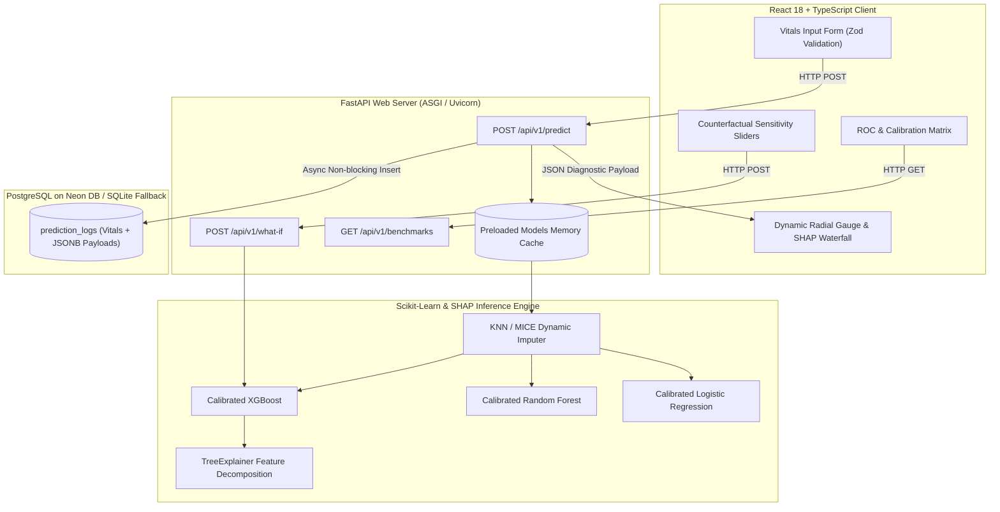

# System Architecture & Technical Design

## 1. Overview
The Heart Disease Clinical Decision Support System (CDSS) is designed with strong architectural cohesion, loose component coupling, and strict non-blocking asynchronous I/O.

## 2. Non-Blocking ML Serving Pattern
FastAPI executes asynchronous endpoints concurrently on the asyncio event loop. However, scientific libraries (like `xgboost`, `scikit-learn`, and `shap`) are CPU-bound. 

To prevent blocking incoming I/O requests:
- Prediction routes are declared as synchronous `def predict(...)`.
- FastAPI dispatches synchronous route handlers to an internal worker thread pool (`anyio.to_thread.run_sync`), keeping the main asyncio event loop free to handle concurrent requests and database connection health checks.

## 3. Dynamic Imputation Strategy
Clinical data in real-world triage often lacks secondary lab results (such as fluoroscopy or thallium scans).
- The pipeline utilizes a pre-fitted `KNNImputer(n_neighbors=5, weights='distance')` for numerical metrics and mode imputation for categorical metrics.
- Missing fields are dynamically tracked and reported to the clinician via a transparent certainty metric:
  $$\text{Certainty Score} = \max\left(50\%, 100\% - (\text{Count of Imputed Secondary Fields} \times 5.3\%)\right)$$

## 4. Probability Calibration (Platt Scaling)
Standard decision tree models output uncalibrated scores that do not reflect true statistical risk percentages. We wrap candidate models with `CalibratedClassifierCV(method='sigmoid', cv='prefit')` on a separate calibration holdout set, producing smooth continuous risk distributions:
- **Low Risk Tier**: $< 35.0\%$
- **Moderate Risk Tier**: $35.0\% - 65.0\%$
- **High Risk Tier**: $> 65.0\%$
